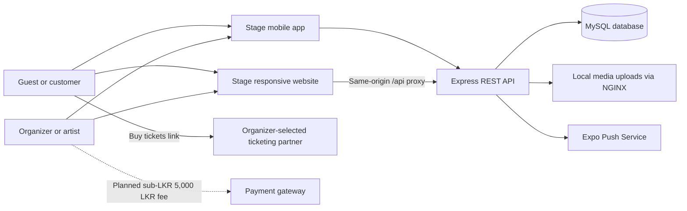

# Stage


## Company Portfolio, Platform Documentation, and Website Policy Pack

**Document version:** 1.0  
**Prepared:** 27 August 2026  
**Platform:** Stage (`com.aahaas.eventsocial`)  
**Market:** Sri Lanka  
**Transaction currency:** Sri Lankan Rupees (LKR) only  
**Primary commercial customer:** Event organizers, promoters, venues, artists, and event companies (B2B)

> This document describes the application as implemented in the current repository and provides publish-ready business and policy wording. Items marked **Planned** are not yet active in the product. Replace all square-bracket placeholders with the company's registered details and obtain Sri Lankan legal review before publishing the policy sections.

### Contents

1. Executive Summary
2. Company Portfolio
3. Products, Prices, Currency, and Transaction Profile
4. Platform Overview
5. Users, Roles, and Access
6. Functional Documentation
7. Core User Journeys
8. Data and Domain Model
9. API Summary
10. Technology and Operations
11. Current Scope, Planned Scope, and Important Limitations
12. Website Terms and Conditions
13. Privacy Policy
14. Stage Organizer Advertisement Refund Policy
15. Recommended Website Placement
16. Payment Implementation Requirements
17. Launch and Governance Checklist
18. Repository Evidence and Document Basis
19. Approval Record
20. Short External Company Description

---

## 1. Executive Summary

Stage is a Sri Lankan event discovery and organizer-publishing platform built to connect people with live events and the companies and artists behind them. It brings event timelines, calendar-based discovery, artist and organizer profiles, reels, ticket information, external ticket links, event reminders, and organizer publishing tools into one connected experience across mobile and web.

Stage is not primarily a direct-to-consumer ticket retailer. Its principal commercial service is business-to-business event advertising and publication. Event organizers pay a small fee to publish or promote an event advertisement on the platform. Every Stage-collected payment is:

- charged only in Sri Lankan Rupees (LKR);
- less than LKR 5,000 per transaction;
- paid by an event organizer or other business user for an event advertising/publication service; and
- separate from the face value of any event ticket shown on Stage.

Customers can browse public events without creating an account. Depending on the event, the platform either sends the customer to the organizer's trusted third-party ticketing page or supports a reservation record. Stage does not currently process paid event-ticket checkout in the inspected implementation.

### Positioning statement

**Stage is Sri Lanka's home for discovering live events and the people behind them. Find it. Follow it. Be there.**

---

## 2. Company Portfolio

### 2.1 Company profile

| Item | Detail |
|---|---|
| Trading/platform name | Stage |
| Registered legal entity | [Company Legal Name] |
| Company registration number | [Registration Number] |
| Registered office | [Registered Address, Sri Lanka] |
| Primary website | [Public Website URL] |
| Customer support email | [Support Email] |
| Privacy contact | [Privacy Email] |
| Telephone | [Business Telephone] |
| Operating market | Sri Lanka |
| Business category | Digital event discovery, event advertising, and organizer publishing platform |
| Primary customers | Event organizers, event companies, promoters, venues, artists, DJs, and bands |
| Consumer audience | People discovering and attending events |
| Accepted currency | LKR only |
| Stage transaction value | Less than LKR 5,000 per transaction |

### 2.2 Vision

To become Sri Lanka's most useful digital stage for live culture: one trusted place where every event can be discovered and every organizer can grow an audience.

### 2.3 Mission

Stage helps organizers publish clear, attractive event information and helps the public discover what is happening by date, place, category, artist, and company. The platform is designed to reduce discovery friction, improve the visibility of local events, and keep audiences informed as event details change.

### 2.4 The problem Stage addresses

Event information is often scattered across social posts, messaging groups, individual ticketing websites, and venue pages. Customers may struggle to compare dates, locations, prices, lineups, or changes. Smaller organizers may also find it difficult to reach an interested audience without running large advertising campaigns.

Stage brings those fragmented details into a structured, searchable platform and gives organizers a dedicated publishing workspace.

### 2.5 The solution

For the public, Stage provides:

- a guest-first event timeline;
- event search and category filters;
- date and calendar discovery;
- artist and organizer profiles;
- event artwork, descriptions, venues, lineups, age guidance, and ticket-price information;
- social sharing and account-based saving;
- company following and event alerts;
- ticket links or reservations, depending on the organizer's setup; and
- mobile push reminders for relevant upcoming events.

For organizers, Stage provides:

- a public organizer profile and handle;
- guided event creation and editing;
- event artwork uploads;
- lineup and social-link management;
- LKR ticket-price display and “price coming soon” support;
- external ticketing-link integration;
- reel/video publishing linked to events;
- event, save, follower, and booking indicators; and
- event update and cancellation notifications.

### 2.6 Value proposition

| Audience | Value delivered |
|---|---|
| Event organizers | A focused, affordable channel for publishing event advertisements and keeping event information current. |
| Artists and performers | A searchable public presence connected directly to upcoming events and media. |
| Venues and promoters | A structured way to present schedules, locations, lineups, and external booking links. |
| Event attendees | One place to discover, compare, follow, save, and receive reminders about events. |
| Ticketing partners | Qualified traffic from event pages to organizer-selected external checkout pages. |

### 2.7 Market focus

Stage is designed for the Sri Lankan market. The application uses the `Asia/Colombo` timezone, presents event prices in LKR, and highlights events across Colombo and other Sri Lankan cities. The platform can support concerts, EDM events, festivals, parties, live performances, nightlife, workshops, cultural events, and other organizer-created categories.

### 2.8 Competitive strengths

- **Organizer-first commercial model:** Stage earns from affordable B2B listing and advertising services rather than relying on large consumer transactions.
- **Low transaction exposure:** every Stage-collected payment is below LKR 5,000.
- **Guest-first discovery:** the core mobile experience is accessible without forcing registration.
- **Calendar-led experience:** users can understand what is happening by date and location.
- **Company and artist identity:** event pages connect audiences to the organization or artist responsible for the event.
- **Event updates and reminders:** followers can be notified when an event is published, meaningfully changed, cancelled, or approaching.
- **External ticketing flexibility:** organizers can continue using their chosen ticketing provider while Stage serves as the discovery and marketing layer.
- **Cross-platform delivery:** responsive web and Expo mobile applications use a shared API and data model.

---

## 3. Products, Prices, Currency, and Transaction Profile

### 3.1 Commercial product

Stage's commercial product is an **event advertisement/publication service for organizers**. The service gives an organizer the ability to publish or promote an event listing using the Stage organizer tools and make it discoverable to Stage's audience.

The organizer's listing may include:

- organizer or company identity;
- event name and description;
- event date, time, venue, city, and age guidance;
- event artwork and flyers;
- ticket categories and LKR price labels;
- lineup and performer social links;
- organizer social links;
- an external ticketing URL; and
- related event reels or promotional media.

### 3.2 Price statement

| Product/service | Customer | Currency | Price per transaction | Frequency |
|---|---|---:|---:|---|
| Event advertisement/publication fee | Event organizer/business user | LKR only | Variable fee, always below **LKR 5,000** | One-time per selected publication or promotion |

The exact fee applicable to an advertisement or publication will be shown to the organizer before payment confirmation. Stage will not submit a charge of LKR 5,000 or more for this service.

### 3.3 Currency policy

- Stage accepts **Sri Lankan Rupees (LKR) only**.
- Stage does not accept USD, EUR, GBP, INR, or any other foreign currency.
- Stage does not provide currency conversion or dynamic currency conversion.
- The organizer's bank or payment provider may apply its own charges under the organizer's separate banking agreement. Those charges are not collected by Stage.

### 3.4 B2B clarification

Stage's paid publication service is not a mass-market consumer product. The payer is normally an event organizer, event company, promoter, venue, artist, DJ, band, or a person acting for such a business. Members of the public can browse event advertisements without paying Stage.

### 3.5 Ticket-price clarification

Event ticket prices displayed on Stage belong to the relevant organizer's event offering. They are not the price of Stage's advertising service and may be different from, or higher than, the Stage publication fee. When an event has an external ticket link, paid checkout and ticket-related payment processing take place on that third-party provider's service under its terms.

Stage's current code also contains reservation and ticket-record functions for events without an external link. These functions create a reservation/ticket record but do not include a live paid checkout gateway. They must not be described as a completed paid ticket purchase unless a compliant payment integration is added.

### 3.6 Payment-gateway business summary

The following statement may be supplied to a bank, acquiring partner, or payment-gateway reviewer:

> Stage operates a Sri Lankan event discovery and organizer-publishing platform. The platform's own paid service is a B2B event advertisement/publication fee charged to event organizers. All Stage transactions are denominated and settled in LKR only, and every individual transaction is below LKR 5,000. Stage is not currently collecting high-value ticket-sale proceeds from consumers. Ticket prices appearing on event pages are event information, and paid ticket checkout may be completed on an organizer-selected third-party ticketing site.

---

## 4. Platform Overview

### 4.1 Product surfaces

| Surface | Technology | Purpose | Current status |
|---|---|---|---|
| Stage mobile app | Expo 54, React Native 0.81, React 19 | Guest event discovery, calendar, alerts, organizer tools, and retained account/ticket/reel modules | Implemented; Android package and build artifacts are present |
| Stage responsive website | Next.js 16, React 19, TypeScript | Public discovery, accounts, tickets, organizer studio, event and reel publishing | Implemented |
| Shared API | Node.js 20+, Express 4, Prisma 5 | Authentication, artists, events, reels, tickets, uploads, follows, and notifications | Implemented |
| Database | MySQL via Prisma | Persistent platform records | Implemented |
| Notification service | Expo Push Service integration | Publication, update, cancellation, and upcoming-event alerts | Implemented |
| Root UI prototype | Static HTML, CSS, and JavaScript | Earlier customer, artist, and admin visual prototype | Reference/prototype only |
| Admin dashboard | Defined in older requirement and prototype documents | Verification, moderation, and operations | Not implemented as a production web route in the inspected app |
| Stage organizer-fee checkout | Payment gateway to collect sub-LKR 5,000 listing fees | B2B monetization | Planned; not implemented in the inspected API or database |

### 4.2 High-level architecture



### 4.3 Brand and experience

- Product name: **Stage**
- Core line: **Find it. Follow it. Be there.**
- Public promise: **One island. Every scene.**
- Mobile style: dark, event-led experience with red/pink accents
- Web style: responsive, imagery-led discovery and guided organizer tools
- Fonts in the mobile application: Sora and Manrope
- Primary audience timezone: GMT+05:30 / Asia/Colombo

### 4.4 Repository map

| Path | Responsibility |
|---|---|
| `Project/` | Expo mobile application, native Android project, mobile features, shared hooks, repositories, and API clients |
| `web/` | Responsive Next.js public website and Organizer Studio |
| `backend/` | Express API, Prisma schema/migrations, notification jobs, uploads, and deployment assets |
| `docs/` | Rework notes, operational guides, feedback records, and this portfolio |
| `RequirementDocs/` | Original product requirements, technical proposals, UI/UX specifications, and diagrams |
| `assets/prototypes/` plus root HTML/CSS/JS | Earlier role-based UI prototype and preview assets |
| Root APK files | Packaged Android application builds supplied for testing/distribution |

---

## 5. Users, Roles, and Access

### 5.1 Guest

A guest does not need an account to browse the main public experience. In the active mobile navigation, guests can access Timeline, Calendar, and Alerts. They can search, open event details, view organizer profiles, follow a company using an installation-specific device identifier, receive enabled push notifications, share an event, and open an external ticketing link.

On the web, public visitors can browse the homepage, events, calendar, artists, reels, and event or artist detail pages.

### 5.2 Registered customer

A registered customer can sign in and use account-linked functionality such as saving events, following artists, reacting to or saving reels where that surface is active, and viewing account-owned tickets. The repository retains a more extensive mobile customer navigation, but the production-oriented mobile boot flow currently defaults to the guest experience.

### 5.3 Organizer/artist

A signed-in user can create an organizer/artist profile with a public handle, description, and category. Organizer tools include public-profile editing, event creation and editing, event artwork uploads, lineup management, ticket-price display, external ticket links, reel uploads, and performance indicators.

The web labels this area **Organizer Studio**. The mobile code labels the equivalent role as artist/manager in several places because the product evolved from EventSocial into Stage.

### 5.4 Administrator

The data model supports an `admin` role, and administrators can perform certain protected API actions, including notification dispatch and editing or deleting another organizer's event. A complete production admin dashboard, verification queue, moderation console, pricing console, and refund console are not present in the current web routes.

### 5.5 Verification behavior

The platform data model stores `isVerified` and `isPreferred` flags for artists/organizers. Reel publication requires a verified profile; preferred profiles publish reels immediately, while other verified profiles enter `pending_approval`.

The current event-creation API requires an organizer/artist profile but does not enforce `isVerified` before creating an event. This differs from the older requirements and should be treated as an implementation gap if verified-only event publishing remains a business requirement.

---

## 6. Functional Documentation

### 6.1 Public event discovery

Users can browse upcoming, live, past, draft, or all events through API filters, with the public interfaces focusing on relevant discoverable events. Search supports event name, venue, city, organizer handle, and organizer name. Category and city filters are also supported.

An event record can contain:

- title and description;
- category and visual color;
- cover and banner artwork plus multiple flyer URLs;
- start and end date/time;
- a “time to be announced” state;
- Asia/Colombo timezone;
- venue, city, full address, and optional coordinates;
- age restriction;
- draft, published, live, cancelled, or ended status;
- organizer identity and profile;
- ordered lineup information and performer social links;
- event social links;
- ticket types, prices, and availability;
- an optional external ticketing link; and
- linked reels, saves, and ticket/reservation counts.

### 6.2 Event details and ticket direction

Event pages show the date, time or time-TBA message, venue or venue-TBA message, city, description, lineup, organizer, ticket choices, and relevant calls to action.

- If `ticketUrl` is present, **Buy tickets** opens the organizer-selected external ticketing provider.
- If `ticketUrl` is absent, the web app can create a reservation using a selected ticket type and the guest or account holder's contact details.
- The active mobile guest flow intentionally routes ticket sales to third parties; its older in-app booking screen remains in the repository but is not wired into active guest navigation.

### 6.3 Calendar and search

The platform supports month and upcoming-event views, date selection, category-based discovery, city/location context, and text search. Past events remain available for historical discovery in selected surfaces, while upcoming events are ordered by start date.

### 6.4 Organizer profiles and following

Public organizer/artist profiles include a handle, name, profile image, category, bio, city, verification indicator, social links, follower count, event count, reel count, upcoming events, and published reels.

Registered users can toggle a persistent account-based follow. Guests can follow through a per-install device identifier. Both approaches feed the canonical follower count and can support relevant notifications.

### 6.5 Organizer Studio

Organizer onboarding creates a public profile and changes the account role to `artist`. The web studio provides:

- overview metrics for upcoming events, booked/reserved tickets, and event saves;
- a list of the organizer's events;
- create, view, edit, and delete actions;
- profile image and public-profile editing;
- new event and new reel workflows; and
- customer-view profile preview.

Event publishing is a guided workflow covering story, schedule, location, artwork, ticket information, external ticket link, and lineup. Events currently publish immediately from the web editor.

### 6.6 Reels and social engagement

The backend supports public reel listing and details, artist/event filters, tags, “for you” and following feeds, reactions, saves, reposts, views, visibility, linked events, video, cover image, and music metadata.

The web includes public reels and a new-reel organizer workflow. The active guest mobile navigation currently has reels disabled, although the reel player, editor, repository, hooks, and customer navigation remain in the codebase.

Customer comments are intentionally not part of the product.

### 6.7 Alerts and push notifications

Stage can register an Expo push token and installation metadata, allow a device to enable or disable notifications, and send:

- new-event publication alerts to followers;
- important event-update alerts;
- cancellation alerts; and
- event reminders at configured lead times, currently five days and one day before an event by default.

The scheduler is aligned to the Asia/Colombo timezone and uses a delivery ledger to reduce duplicate sends. Permanent token failures can retire a device token. Guests can also read an in-app reminder feed for events within a defined upcoming window.

### 6.8 Authentication and accounts

Implemented authentication uses email and password. Passwords are hashed with bcrypt, and successful signup/login returns a Bearer JWT. The web stores the session in browser local storage; the mobile app uses AsyncStorage. Profile completion can add or update name, phone, city, and avatar.

The “forgot password” mobile screen currently displays a success-style message but the inspected backend has no password-reset endpoint or email-delivery workflow. It should not be represented publicly as a completed recovery feature.

### 6.9 Media uploads

Authenticated users can upload:

- videos in MP4, QuickTime, WebM, or M4V format, up to 100 MB by default; and
- JPEG, PNG, WebP, or GIF images, up to 10 MB by default.

The API randomizes stored filenames and validates MIME type and file size. Current deployment documentation places uploads on server-local storage and serves them through NGINX. Durable off-site media backup is not yet documented as active.

---

## 7. Core User Journeys

### 7.1 Guest discovers an event

1. Open Stage without registering.
2. Browse Timeline or Calendar.
3. Search or filter by date, city, category, company, or event.
4. Open an event to review details, artwork, lineup, location, and ticket information.
5. Follow the organizer or enable alerts.
6. Open the organizer's external ticketing partner when a ticket link is supplied.

### 7.2 Organizer publishes an event

1. Sign up or sign in.
2. Complete the user profile.
3. Create an organizer profile and public handle.
4. Enter event details, date/time, venue/city, artwork, ticket information, and lineup.
5. Add an external ticketing link when paid tickets are sold elsewhere.
6. Publish the event.
7. Return to Studio to update price, venue, date, ticket link, or lineup.
8. Followers receive relevant publication or material-change alerts.

### 7.3 Organizer purchases a Stage advertisement/publication service — Planned

1. Organizer completes the event advertisement.
2. Stage displays the applicable publication fee in LKR.
3. Organizer confirms the service and policy acceptance.
4. Stage creates a payment attempt for an amount below LKR 5,000.
5. The payment provider confirms payment through a verified callback/webhook.
6. Stage issues a receipt and publishes or schedules the advertisement.
7. Any refund request follows the Stage Organizer Advertisement Refund Policy in this document.

This payment journey is a business requirement for monetization; it is not implemented in the current repository.

---

## 8. Data and Domain Model

The implemented Prisma schema contains the following principal entities:

| Entity | Purpose |
|---|---|
| `User` | Account identity, contact information, role, and profile image |
| `Artist` | Organizer/artist public profile, verification, preferred status, and aggregate counts |
| `Event` | Event content, schedule, venue, media, organizer, status, and external ticket link |
| `TicketType` | Display name, price label, amount, LKR currency, and available quantity |
| `Ticket` | Account or guest reservation/ticket record, holder details, QR payload, and status |
| `LineupEntry` | Relationship between events and registered artists |
| `Reel` and `ReelTag` | Organizer media, linked event, status, visibility, and tags |
| `Follow` and `GuestFollow` | Account-based and device-based organizer following |
| `SavedEvent` and `SavedReel` | User collections |
| `ReelReaction` and `ReelRepost` | Social engagement without comments |
| `PushDevice` | Installation ID, Expo token, platform, app version, and delivery state |
| `NotificationDelivery` | Notification deduplication, result, and receipt tracking |

The implemented schema does **not** currently contain orders, listing packages, organizer-fee invoices, payment attempts, payment webhooks, settlements, or platform-fee refund records. Those are required before Stage can collect organizer publication fees safely.

---

## 9. API Summary

The API is mounted under `/api` and returns JSON.

| Area | Key endpoints | Access |
|---|---|---|
| Health | `GET /health` | Public |
| Authentication | `POST /auth/signup`, `POST /auth/login`, `GET /auth/me`, `PATCH /auth/complete-profile` | Mixed |
| Artists/organizers | List, detail, own profile, become artist, update profile, account follow, guest follow | Mixed |
| Events | List, detail, create, update, delete, save | Public reads; authenticated writes |
| Reels | List, detail, create, react, save, repost | Public reads; authenticated engagement/publishing |
| Tickets | Guest reservation, list mine, detail, create, update status | Mixed |
| Uploads | Image and video upload | Authenticated |
| Notifications | Feed, device registration/settings, test, admin dispatch | Mixed |

Input is validated with Zod. The server uses a standard validation/error response shape and applies general plus authentication-specific rate limits.

---

## 10. Technology and Operations

### 10.1 Implemented stack

- **Mobile:** Expo, React Native, React, Expo Notifications, Expo Image Picker, AsyncStorage
- **Web:** Next.js, React, TypeScript, Lucide icons
- **API:** Node.js, Express, Prisma, Zod
- **Database:** MySQL
- **Authentication:** bcrypt password hashing and signed JWT Bearer tokens
- **Infrastructure described in the repository:** Google Cloud-hosted environment, PM2 process management, NGINX reverse proxy/static upload delivery, and TLS through Let's Encrypt
- **Push delivery:** Expo Push Service

### 10.2 Request and security controls

Implemented controls include:

- password hashing rather than plaintext storage;
- JWT verification for protected endpoints;
- role checks on selected administrator operations;
- owner checks for event edits/deletes and ticket access;
- Zod request validation;
- Helmet security headers;
- configurable CORS;
- global and authentication-specific rate limiting;
- upload MIME/size validation and randomized filenames;
- parameterized database access through Prisma; and
- production environment validation for critical secrets.

### 10.3 Operational requirements before commercial launch

- Use HTTPS for every public web, API, media, and payment URL.
- Set a strong unique production JWT secret and restrict CORS to approved origins.
- Never use the development seed password or demo accounts in production.
- Enable automated MySQL backups and tested restore procedures.
- Move important uploaded media to backed-up object storage or add a verified local-storage backup.
- Add centralized error monitoring, uptime checks, and an incident-response owner.
- Add account deletion/data export workflows and a working password-reset process.
- Add an admin verification/moderation surface or an audited operational alternative.
- Complete a security assessment before enabling a payment gateway.

### 10.4 Local development

Run each product surface from its own directory.

**API**

```powershell
cd backend
npm install
# Configure DATABASE_URL and JWT_SECRET in backend/.env
npx prisma generate
npx prisma migrate dev
npm run dev
```

The default development health endpoint is `http://localhost:8000/api/health`.

**Responsive website**

```powershell
cd web
npm install
# Optionally set API_BASE_URL in .env.local
npm run dev
```

The default website development address is `http://localhost:3000`. Next.js proxies browser requests from `/api/*` to the configured Stage API.

**Mobile application**

```powershell
cd Project
npm install
$env:EXPO_PUBLIC_API_BASE_URL = "http://<development-host>:8000/api"
npm start
```

Use a host address reachable from the emulator or physical device rather than `localhost` when the API is running on another machine. The repository also supplies `npm run android` and `npm run ios` commands for native development builds.

### 10.5 Production configuration observed in the repository

The mobile and website API clients currently default to `https://events-api.aahaas.com/api`. Deployment assets describe NGINX proxying, PM2 process supervision, HTTPS termination, Prisma migration handling, a MySQL database, and static delivery of `/uploads/*`. Environment configuration should remain the source of truth so staging and production targets can be changed without editing application code.

---

## 11. Current Scope, Planned Scope, and Important Limitations

| Capability | Status | Note |
|---|---|---|
| Public event browsing | Available | Guest-first on mobile and public on web |
| Calendar/search/category discovery | Available | Location is currently based primarily on city and optional coordinates |
| Organizer profiles and following | Available | Supports account and guest/device follows |
| Organizer event CRUD | Available | Web and mobile tools present |
| Event artwork and media uploads | Available | Stored on server-local disk in current deployment design |
| External ticket links | Available | Preferred active paid-ticket route in mobile guest flow |
| Free/account/guest reservation records | Available in API/web | No payment capture |
| Paid consumer ticket checkout | Not implemented | Must not be advertised as an active Stage checkout service |
| Organizer listing-fee checkout | Not implemented | Business model defined; gateway and ledger still required |
| LKR ticket display | Available | Web/mobile creators hard-code LKR for price display |
| Strict server-side LKR-only validation | Partial | API defaults to LKR but currently accepts another currency string; enforce before payment launch |
| Strict server-side sub-LKR 5,000 Stage fee limit | Not implemented | No organizer-fee payment model exists yet |
| Reels | Available on web/API; retained on mobile | Active guest mobile tab currently disabled |
| Push reminders | Available | Expo-based, defaults include five-day and one-day reminders |
| Verified-only reel publication | Available | Non-preferred verified artists enter pending approval |
| Verified-only event publication | Not fully enforced | Current event create API checks profile presence, not verification flag |
| Full admin dashboard | Not implemented | Prototype/requirements exist only |
| Password reset | Not implemented end to end | Mobile screen is present; backend/email workflow is absent |
| Terms and Privacy navigation | Incomplete | Mobile text exists but is not linked; web footer has no legal links |
| Account deletion/privacy requests | Not implemented in UI/API | Must be added or handled manually through published contact details |

---

## 12. Website Terms and Conditions

**Effective date:** [Effective Date]  
**Last updated:** 27 August 2026

### 12.1 About these Terms

These Terms and Conditions govern access to and use of the Stage website, mobile application, organizer tools, event-advertising services, and related services (together, the **Platform**). The Platform is operated by **[Company Legal Name]**, registered in Sri Lanka under number **[Registration Number]**, with its registered office at **[Registered Address]** (**Stage**, **we**, **us**, or **our**).

By using the Platform, creating an account, publishing content, or purchasing an organizer service, you agree to these Terms. If you use Stage on behalf of a company or organization, you confirm that you are authorized to bind it to these Terms.

### 12.2 Eligibility and accounts

You must provide accurate information and keep your login credentials secure. You are responsible for activity performed through your account. Notify us promptly at **[Support Email]** if you believe your account has been compromised.

Users must be legally capable of accepting these Terms. Where an event has an age restriction, the organizer and attendee are responsible for complying with it.

### 12.3 Platform role

Stage provides event discovery, event-information publishing, organizer profiles, promotional media, alerts, and related organizer advertising services. Unless Stage expressly identifies itself as the ticket seller or contracting event organizer, Stage does not organize the event and is not the seller of tickets offered on an external ticketing website.

Organizers are responsible for the accuracy, legality, safety, availability, pricing, venue, schedule, lineup, licensing, and delivery of their events. Customers should review the organizer's and external ticket provider's terms before purchasing a ticket.

### 12.4 Organizer advertising/publication services

An organizer may purchase the right to publish or promote an event advertisement. The applicable fee is displayed before payment, is charged in LKR only, and is always less than LKR 5,000 per transaction. Payment purchases a digital advertising/publication service; it does not purchase an event ticket or transfer ticket-sale revenue through Stage.

Stage may review, reject, suspend, edit for formatting, unpublish, or remove an advertisement that is misleading, unlawful, unsafe, infringing, technically harmful, or inconsistent with these Terms. Removal for an organizer's breach may be non-refundable as stated in the Refund Policy.

### 12.5 Organizer obligations

Organizers must:

- publish complete and accurate event information;
- have authority to advertise the event, venue, artists, brands, and ticket link;
- keep dates, venues, lineups, prices, availability, cancellations, and ticket links updated;
- hold all required permits, approvals, music/media rights, public-performance rights, and insurance;
- honor lawful customer commitments made through their own ticketing arrangements;
- comply with Sri Lankan law, consumer-protection obligations, and payment-provider rules; and
- avoid deceptive claims, counterfeit tickets, prohibited goods/services, hate content, illegal activity, malware, or intellectual-property infringement.

### 12.6 User content and licence

You retain ownership of content you submit. You grant Stage a non-exclusive, worldwide, royalty-free licence to host, store, reproduce, format, display, distribute, and promote that content only as needed to operate, market, and improve the Platform and the relevant event listing.

You confirm that you own the content or have all permissions necessary to grant this licence. Stage may remove content in response to a valid complaint or legal request.

### 12.7 Acceptable use

You must not:

- impersonate another person or organization;
- access another user's account without permission;
- scrape, overload, reverse engineer, disrupt, or probe the Platform except where law expressly permits;
- upload malicious code or unlawful content;
- manipulate follower, engagement, reservation, or ticket counts;
- use Stage to defraud customers or redirect them to unsafe payment pages; or
- collect or misuse another user's personal information.

### 12.8 Event tickets and external services

An external ticket link takes you to a service not controlled by Stage. That provider's prices, payment terms, privacy notice, delivery terms, cancellation rules, and refund rules apply to the ticket purchase. Stage is not responsible for the availability, security, or performance of an external site, although users may report a suspicious link to **[Support Email]**.

Any Stage reservation record that does not involve payment is evidence of the recorded reservation only. Admission remains subject to the event organizer's validation, capacity, and event rules.

### 12.9 Fees, currency, and taxes

Stage organizer fees are quoted and charged in LKR only. The total Stage charge is shown before confirmation and will be below LKR 5,000 per transaction. Any applicable tax or mandatory charge will be included in, or clearly shown as part of, the total before payment. Users are responsible for charges imposed separately by their bank or payment provider.

### 12.10 Cancellations and refunds

Refunds of Stage organizer advertisement/publication fees are governed by the **Stage Organizer Advertisement Refund Policy** below. Ticket refunds for purchases completed on an external platform must be requested from the organizer or relevant ticketing provider.

### 12.11 Availability and changes

We aim to keep Stage available but do not guarantee uninterrupted or error-free access. Features may change, be suspended, or be discontinued for maintenance, security, legal, or business reasons. We may update these Terms and will publish the new effective date. Material changes may also be communicated through the Platform or registered contact details.

### 12.12 Intellectual property

The Stage name, logos, interface, software, and original platform content belong to Stage or its licensors. These Terms do not transfer those rights. Third-party event names, artwork, performer names, and trademarks remain the property of their respective owners.

### 12.13 Disclaimers and limitation of liability

To the extent permitted by law, the Platform is provided on an “as available” basis. Stage is not responsible for an organizer's event performance, cancellation, venue conditions, artist appearance, ticket delivery, attendee conduct, or an external provider's checkout.

Nothing in these Terms excludes liability that cannot lawfully be excluded. Subject to that rule, Stage's aggregate liability arising from a paid organizer advertising service will not exceed the Stage fee paid for the specific service giving rise to the claim.

### 12.14 Suspension and termination

Stage may restrict or terminate access for breach, fraud risk, unlawful conduct, non-payment, repeated complaints, or security concerns. A user may stop using Stage at any time and may request account closure through **[Support Email]**. Certain records may be retained where required for legal, security, accounting, dispute, or fraud-prevention purposes.

### 12.15 Governing law and contact

These Terms are governed by the laws of Sri Lanka. The courts of Sri Lanka will have jurisdiction, subject to any mandatory dispute-resolution or consumer right that applies by law.

Questions may be sent to:

**[Company Legal Name]**  
**[Registered Address]**  
**[Support Email]**  
**[Business Telephone]**

---

## 13. Privacy Policy

**Effective date:** [Effective Date]  
**Last updated:** 27 August 2026

### 13.1 Scope

This Privacy Policy explains how **[Company Legal Name]**, trading as Stage, handles personal information when people use the Stage website, mobile application, organizer tools, alerts, and support channels.

### 13.2 Information Stage may collect

Depending on how a person uses Stage, the Platform may collect:

- **Account information:** name, email address, password hash, phone number, city, role, profile image, and account creation date.
- **Organizer/artist information:** public handle, bio, category, social links, verification/preferred status, follower counts, and event/reel statistics.
- **Event and media content:** event titles, descriptions, dates, venues, addresses, coordinates, age guidance, ticket information, external ticket links, artwork, videos, captions, tags, music metadata, and lineup details.
- **Engagement information:** follows, guest follows, saved events, saved reels, reactions, reposts, reservations, ticket status, and related timestamps.
- **Reservation information:** ticket holder or guest name, phone number, optional email address, ticket type, event, and reservation/QR reference.
- **Device and notification information:** installation/device identifier, Expo push token, platform, application version, notification preference, delivery attempts, failures, and receipts.
- **Technical and security information:** request time, IP address or proxy-derived network information, browser/device information, logs, rate-limit information, and error details where generated by the service infrastructure.
- **Payment information for planned organizer fees:** amount in LKR, service description, provider reference, status, receipt, refund, and fraud-check information. Card credentials should be collected directly by the approved payment provider and should not be stored by Stage.
- **Support information:** messages, reports, complaints, attachments, and correspondence sent to Stage.

### 13.3 How Stage uses information

Stage may use personal information to:

- create and secure accounts;
- provide event discovery, organizer profiles, listings, reels, reservations, saves, follows, and alerts;
- process and record organizer advertising/publication payments when that service is launched;
- send publication, update, cancellation, and upcoming-event notifications;
- operate customer support and investigate reports;
- prevent fraud, abuse, unauthorized access, and harmful content;
- measure feature performance and improve the Platform;
- maintain accounting, legal, audit, and operational records; and
- comply with law and enforce the Terms.

### 13.4 Lawful grounds

Depending on the activity and applicable Sri Lankan law, Stage handles information because it is needed to perform a contract, because the user has given consent, because Stage has a legitimate operational or security interest, or because Stage must comply with a legal obligation.

### 13.5 Public information

Organizer profiles, handles, bios, profile images, social links, events, lineups, artwork, reels, prices, and other content intentionally published through Stage may be visible publicly and may be shared outside the Platform. Organizers should not publish private or confidential information in these fields.

### 13.6 Sharing and service providers

Stage may share information only as necessary with:

- hosting, database, reverse-proxy, storage, monitoring, and technical service providers;
- Expo Push Service for mobile notification delivery;
- an approved payment gateway/acquirer for planned organizer-fee payments;
- external ticketing services when a user chooses to follow an organizer-provided link;
- professional advisers, auditors, insurers, and authorities where legally required; and
- a successor entity as part of a lawful merger, financing, restructuring, or sale.

External ticketing services collect information under their own privacy policies. Stage does not control information a user provides after leaving Stage for an external site.

### 13.7 Cookies and local storage

The current web application stores the signed-in session token and user record in browser local storage. The mobile app stores equivalent session information in application storage. If analytics, advertising cookies, or non-essential tracking technologies are later added, Stage should update this Policy and display any consent mechanism required by law.

### 13.8 Data retention

Stage retains information only for as long as reasonably needed to provide the service, maintain security and records, resolve disputes, meet accounting/legal obligations, and enforce agreements. Public content may remain until the organizer deletes it or the account is closed, subject to backup, legal, and dispute-retention needs. Notification delivery records should follow an operational retention schedule; the current backend defaults to pruning old delivery records after a configured period.

### 13.9 Security

Stage uses safeguards such as password hashing, JWT authentication, access controls, request validation, rate limiting, security headers, randomized upload filenames, TLS in production deployment, and restricted administrative operations. No system can guarantee absolute security. Users should use a unique password and report suspected unauthorized access promptly.

### 13.10 User choices and rights

Subject to applicable law, a person may ask Stage to:

- provide access to personal information;
- correct inaccurate information;
- delete an account or eligible information;
- restrict or object to certain processing;
- withdraw consent where processing relies on consent; or
- provide information about a privacy concern.

Requests should be sent to **[Privacy Email]**. Stage may need to verify identity and may retain information where law or a legitimate legal/security requirement permits it.

Users can disable push notifications through device settings and, where available, the application's notification setting. A user can also unfollow a company or artist to stop follower-based alerts.

### 13.11 Children

Stage is a general event-discovery platform and is not intentionally directed at young children. Event age restrictions are displayed where supplied by organizers. A parent or guardian who believes a child has provided personal information without appropriate authorization should contact **[Privacy Email]**.

### 13.12 International processing

Some technology providers may process information outside Sri Lanka. Where this occurs, Stage will use appropriate contractual and security safeguards required by applicable law.

### 13.13 Changes and contact

Stage may update this Policy and will publish the revised date. Material changes may be communicated through the Platform.

Privacy questions and requests may be sent to:

**Data/Privacy Contact — [Company Legal Name]**  
**[Registered Address]**  
**[Privacy Email]**  
**[Business Telephone]**

---

## 14. Stage Organizer Advertisement Refund Policy

**Effective date:** [Effective Date]  
**Last updated:** 27 August 2026

### 14.1 Scope

This policy applies only to fees paid directly to Stage for an organizer's event advertisement/publication service. Each Stage fee is charged in LKR and is below LKR 5,000.

This policy does not apply to event tickets bought through an organizer, venue, or external ticketing partner. Ticket refund requests must be made to the relevant seller under that seller's policy.

### 14.2 Refund eligibility

An organizer may request a full refund of the Stage fee when:

- Stage charged the same transaction more than once;
- payment succeeded but a Stage technical failure prevented the purchased advertisement from being published and Stage cannot restore the service within a reasonable period;
- Stage is unable to provide the purchased service for an internal operational reason; or
- Stage rejects the advertisement before publication for a reason unrelated to the organizer's breach of the Terms.

### 14.3 Non-refundable circumstances

A Stage advertisement/publication fee is normally non-refundable when:

- the advertisement has already been published or the purchased promotion has started;
- the organizer cancels, postpones, relocates, or materially changes the event;
- the organizer submitted inaccurate, unlawful, misleading, infringing, unsafe, or prohibited content;
- Stage removes or suspends the advertisement because the organizer breached the Terms;
- the organizer did not provide usable content or did not complete required publication details; or
- the organizer changes its mind after Stage has begun providing the digital advertising service.

This does not limit any non-excludable right available under applicable law.

### 14.4 How to request a refund

Send a request to **[Support Email]** with:

- organizer/company name;
- Stage account email;
- event or advertisement name;
- payment date and amount;
- payment/provider reference; and
- a short explanation and supporting evidence.

Requests should be submitted within **7 calendar days** of the payment or the date the issue was discovered, whichever is later. Unauthorized transactions should be reported immediately.

### 14.5 Review and payment

Stage will acknowledge the request and may ask for additional verification. Approved refunds will be sent to the original payment method wherever possible. Stage aims to initiate an approved refund within **5 business days**; the bank or payment provider may require additional processing time. Stage does not refund separate bank, card, or provider fees that it did not collect.

### 14.6 Event-ticket refunds

If an event is cancelled, postponed, or changed, customers must follow the ticket seller's or organizer's refund process shown on the external ticketing site or event communication. Stage may publish cancellation information and send alerts, but it cannot issue a refund for funds it did not collect.

### 14.7 Contact

**[Company Legal Name]**  
**[Support Email]**  
**[Business Telephone]**

---

## 15. Recommended Website Placement

To make the commercial model transparent and suitable for payment-gateway review, the public website should contain permanent, accessible pages at paths such as:

| Page | Recommended path | Required content |
|---|---|---|
| About Stage / Company Profile | `/about` | Legal company identity, platform purpose, Sri Lankan market, contact details |
| Products & Pricing | `/pricing` | Organizer advertising service, exact/range fee, below-LKR 5,000 limit, LKR-only statement |
| Terms and Conditions | `/terms` | Section 12 of this document |
| Privacy Policy | `/privacy` | Section 13 of this document |
| Refund Policy | `/refund-policy` | Section 14 of this document |
| Contact | `/contact` | Registered name/address, support email, telephone, response hours |

The footer should link to all five legal/business pages. Signup and organizer checkout should require an affirmative acceptance checkbox linked to the Terms and Privacy Policy. The organizer payment screen should also link to the Refund Policy and display:

- the product/service name;
- organizer/event name;
- amount in LKR;
- confirmation that no other currency is accepted;
- a total below LKR 5,000;
- refund-policy link;
- business contact information; and
- payment-provider branding and secure-checkout notice.

The current repository does not contain these linked web pages. The mobile signup/welcome screens display “Terms” and “Privacy Policy” text without navigation actions, and the current web footer does not display legal-policy links.

---

## 16. Payment Implementation Requirements — Before Accepting Organizer Fees

The following work is required before enabling the Stage publication fee:

1. Create a server-controlled product/package catalogue. Do not trust a price submitted by a browser or mobile client.
2. Enforce `currency = LKR` on the server and reject every other currency.
3. Enforce an integer minor-unit amount greater than zero and strictly below LKR 5,000.
4. Create order/payment-attempt, webhook-event, receipt, and refund records.
5. Use provider idempotency keys so retries cannot create duplicate charges.
6. Verify webhook signatures and treat the provider callback, not the browser redirect, as payment confirmation.
7. Link each successful payment to the organizer, event advertisement, package, amount, and timestamps.
8. Provide a payment receipt and a support-visible transaction reference.
9. Add an administrator view for payment status, duplicate detection, refund decisions, and audit history.
10. Never store card number, CVV, or online-banking credentials in Stage's database or logs.
11. Add reconciliation, settlement, chargeback, and failed-payment procedures.
12. Test successful, declined, cancelled, timed-out, repeated, tampered, and refunded payments.

Suggested invariant:

```text
currency == "LKR"
0 < amount_lkr < 5000
product_type == "ORGANIZER_EVENT_ADVERTISEMENT"
payer_role in {artist, organizer, promoter, venue, event_company}
```

---

## 17. Launch and Governance Checklist

### Company and legal

- [ ] Replace all company, registration, address, email, telephone, website, and effective-date placeholders.
- [ ] Confirm the exact organizer product names and exact LKR prices or pricing rule.
- [ ] Obtain Sri Lankan legal review of Terms, Privacy Policy, Refund Policy, consumer disclosures, and data-handling obligations.
- [ ] Confirm tax treatment and how taxes appear in the displayed total.
- [ ] Assign a support owner and privacy contact.

### Website

- [ ] Add About, Pricing, Terms, Privacy, Refund, and Contact routes.
- [ ] Link every legal page in the web footer and relevant mobile screens.
- [ ] Add policy acceptance records with policy version and timestamp.
- [ ] Clearly distinguish Stage organizer fees from event ticket prices.
- [ ] Remove or qualify any wording that implies Stage currently provides paid ticket checkout.

### Product and engineering

- [ ] Implement the organizer-fee payment data model and gateway flow.
- [ ] Enforce LKR-only and less-than-LKR 5,000 rules on the server.
- [ ] Complete password reset and account deletion/export workflows.
- [ ] Decide and enforce verified-only event publishing.
- [ ] Deliver the operational admin/verification/moderation tools.
- [ ] Add durable media backup and test database restores.
- [ ] Security-test payment, authentication, uploads, authorization, and webhooks.

### Operations

- [ ] Publish support and refund response targets.
- [ ] Create incident, refund, chargeback, and suspicious-organizer procedures.
- [ ] Configure production monitoring and alerting.
- [ ] Maintain payment and refund reconciliation records.
- [ ] Review policies whenever the business model, providers, data collection, or ticketing role changes.

---

## 18. Repository Evidence and Document Basis

This portfolio was prepared by inspecting the current repository, including:

- `Project/App.js` and the active guest/customer/artist navigation;
- mobile event, calendar, search, notification, organizer, reel, ticket, and authentication screens;
- `web/app` routes and shared website components;
- the web organizer Studio and event editor;
- Express routes, controllers, services, validation schemas, and middleware;
- the implemented Prisma/MySQL schema and migrations;
- notification scheduler and push delivery logic;
- web/mobile API configuration;
- deployment documentation and NGINX configuration; and
- older requirements and prototype documents, used only to identify planned scope.

Where an older requirement conflicts with current code, this document describes current code as **Available** and the older intention as **Planned** or an implementation gap. In particular, the current backend is Express + Prisma + MySQL, even though older design documents proposed NestJS + PostgreSQL/PostGIS; and payments remain planned even though older proposals discuss broader ticket-commerce functionality.

---

## 19. Approval Record

| Role | Name | Signature/approval | Date |
|---|---|---|---|
| Company director/authorized officer | [Name] | [Approval] | [Date] |
| Product owner | [Name] | [Approval] | [Date] |
| Legal reviewer | [Name/Firm] | [Approval] | [Date] |
| Technical owner | [Name] | [Approval] | [Date] |

---

## 20. Short External Company Description

> **Stage is a Sri Lankan event discovery and organizer-publishing platform.** It helps event companies, promoters, venues, and artists publish event advertisements, present lineups and ticket information, connect audiences to trusted external ticketing partners, and keep followers informed through calendars and alerts. Stage's own paid product is an affordable B2B event advertisement/publication service. All payments to Stage are accepted in LKR only, and every transaction is below LKR 5,000.

---

**End of document**
